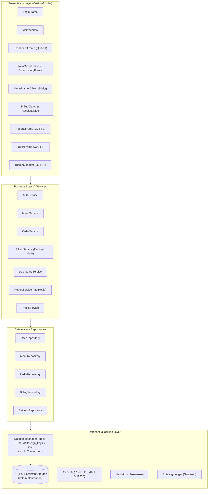
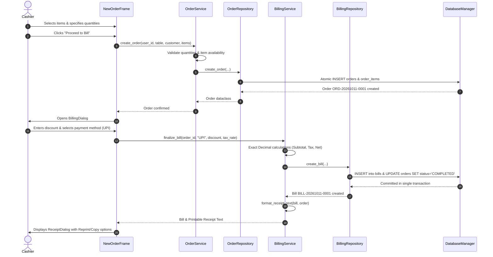

# Software Architecture Specification

- **Project:** Restaurant Billing System
- **Subject:** BBAT104 — Fundamentals of Total Quality Management
- **Student Name:** Jay Paneru
- **Registration Number:** 2410302024
- **Assigned Quality Goal:** Q08 — Improve User Satisfaction
- **Document Version:** 1.0.0
- **Status:** Approved

---

## 1. Architectural Style & Design Principles

The Restaurant Billing System is built following a strict **Layered (N-Tier) Architecture** pattern, enforcing the **Separation of Concerns (SoC)** principle and high maintainability.

### Key Design Principles:
1. **Zero SQL in Presentation:** UI event handlers never execute raw SQL statements. UI frames only communicate through strongly typed services.
2. **Fixed-Point Financial Exactness:** Monetary values are modeled and calculated using Python `Decimal` with two decimal places of precision (`quantize(Decimal("0.01"))`). Floating-point arithmetic is forbidden in financial pipelines.
3. **Poka-Yoke Input Gates:** Data is validated at the presentation boundary before invoking services, and re-validated at the service layer before reaching database repositories.
4. **Historical Price Protection:** Invoices record static snapshot values (`item_name`, `unit_price`, `line_total`) to prevent mutations when active catalog prices are adjusted.

---

## 2. Component Responsibilities

### 2.1 Presentation Layer (`ui/`)
- **`LoginFrame`:** Collects credentials, shows feedback, and triggers theme initialization.
- **`MainWindow`:** Top-level navigation shell, header with user pill and theme toggle, bottom academic status bar, and root keyboard shortcuts binding (`Alt+N`, `Alt+D`, `Alt+M`, `Alt+O`, `Alt+R`, `Alt+P`, `Alt+T`, `Esc`).
- **`DashboardFrame`:** Displays real-time metric cards, recent orders, and top selling dishes.
- **`NewOrderFrame`:** Point-of-sale catalog picker, cart manager, and table number inputs.
- **`MenuFrame`:** CRUD catalog manager with category filters and search bar.
- **`BillingDialog` & `ReceiptDialog`:** Settle order totals with taxes, discounts, tender selection, and monospace thermal receipt generation.
- **`ReportsFrame`:** Embeds Matplotlib figures directly using `FigureCanvasTkAgg`.
- **`ProfileFrame`:** Displays user account, allows updating display name, password changes, and preferences.
- **`ThemeManager`:** Dispatches theme events to registered listeners for live re-theming without restart.

### 2.2 Service Layer (`services/`)
- Encapsulates domain logic, discount policies, state transition enforcement (e.g. `PENDING` -> `COMPLETED`), aggregation queries, and receipt text formatting.

### 2.3 Repository Layer (`repositories/`)
- Handles parameterized SQL queries, mapping database records into strongly typed domain dataclasses (`User`, `MenuItem`, `Order`, `OrderItem`, `Bill`).

### 2.4 Database & Persistence Layer (`database/`)
- **`DatabaseManager`:** Manages connections, enforces SQLite foreign keys (`PRAGMA foreign_keys = ON;`), and provides atomic transaction context blocks with rollback on exceptions.

---

## 3. Core Workflow Sequence Diagrams

### 3.1 Order to Billing Workflow

---

## 4. Security Architecture

1. **Password Protection:** Plaintext passwords are never stored. Passwords are salted with 16 bytes of cryptographically secure random bytes from `os.urandom(16)` and hashed using **PBKDF2-HMAC-SHA256** with **100,000 iterations**.
2. **Credential Verification:** Uses `hmac.compare_digest` to prevent timing attacks.
3. **Sensitive Data Redaction:** Rotating log files in `logs/` filter out passwords and tokens using regular expression pattern matching.
4. **Parameterized Queries:** 100% of SQL queries use DB-API parameter substitution (`?`), eliminating SQL injection vulnerabilities.
