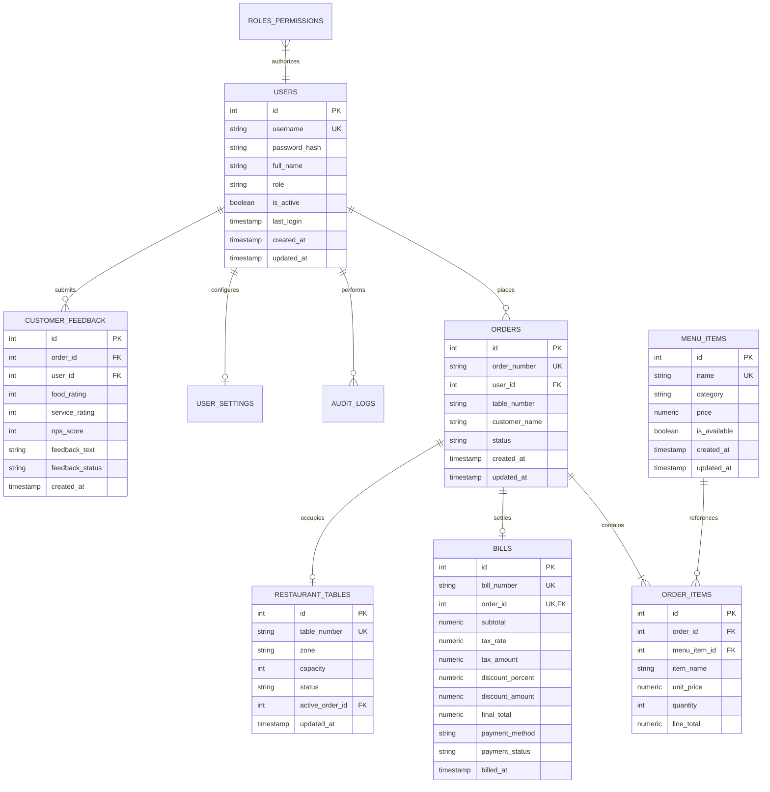

# SYSTEM ARCHITECTURE & DATABASE DESIGN SPECIFICATION
## Enterprise Restaurant Management Platform — Architectural Reference
**Academic Course:** BBAT104 — Fundamentals of Total Quality Management  
**Student Name:** Jay Paneru | **Registration Number:** 2410302024  
**Quality Goal:** Q08 — Improve User Satisfaction | **Session:** 2026–27

---

## 1. High-Level Modular System Architecture

The platform follows a clean, decoupled **3-Tier Layered Architecture** adhering to Separation of Concerns (SoC) and SOLID design principles.

```mermaid
flowchart TD
    subgraph PRESENTATION["Presentation Layer (CustomTkinter UI & Theming)"]
        MW["MainWindow (Router & Shell)"]
        AUTH_UI["LoginFrame & CustomerRegisterDialog"]
        ADM_UI["Admin Governance (Users, Roles, Settings, Audit)"]
        MGR_UI["Manager Floor (Tables, Active Orders, Shifts)"]
        POS_UI["Cashier POS (Billing, Split Billing, Receipts)"]
        KDS_UI["Chef Kitchen Display System (KDS)"]
        CUST_UI["Customer Dining Portal & Feedback (Q08)"]
        THEME["ThemeManager (Midnight Obsidian Dark / Light)"]
    end

    subgraph BUSINESS["Service / Business Logic Layer"]
        AUTH_SVC["AuthService (PBKDF2 Hashing, RBAC Guard)"]
        ORDER_SVC["OrderService (Validation, Lifecycle Pipeline)"]
        BILL_SVC["BillingService (Taxes, Discounts, Split Reconcile)"]
        DASH_SVC["DashboardService (Analytics, KPI Telemetry)"]
        REP_SVC["ReportService (CSV Export, Shift Audit)"]
    end

    subgraph DATA_ACCESS["Repository & Data Access Layer"]
        USER_REPO["UserRepository"]
        ORDER_REPO["OrderRepository"]
        MENU_REPO["MenuRepository"]
        BILL_REPO["BillingRepository"]
        AUDIT_REPO["AuditRepository"]
        SETT_REPO["SettingsRepository"]
    end

    subgraph PERSISTENCE["Database Persistence Layer"]
        DB_MGR["DatabaseManager (SQLite 3.x with WAL Mode)"]
        SCHEMA["Schema & Auto-Migrations"]
        BACKUP["Backup & Restore Subsystem"]
    end

    PRESENTATION --> BUSINESS
    BUSINESS --> DATA_ACCESS
    DATA_ACCESS --> PERSISTENCE
```

---

## 2. Relational Database Schema & Entity Relationships

The relational persistence model consists of 11 tightly normalized tables enforcing primary/foreign keys, unique constraints, and check guards.

---

## 3. Concurrency, WAL Mode & Data Integrity

1. **Write-Ahead Logging (WAL Mode):**
   - SQLite by default blocks readers during writes.
   - The application automatically initializes `PRAGMA journal_mode = WAL;`, enabling simultaneous read operations while write transactions proceed.
   - `PRAGMA synchronous = NORMAL;` delivers maximum I/O throughput without risking database integrity during application restarts.
   - `PRAGMA foreign_keys = ON;` guarantees strict referential integrity.

2. **Automated Backup & Disaster Recovery:**
   - Every database modification can be snapshot-backed into `data/backups/`.
   - Automated verified backups store full SQLite snapshots with timestamped naming (e.g., `restaurant_20261102_215040.bak`).
   - The restore subsystem validates SQLite file headers and runs `PRAGMA integrity_check` before committing restoration.

3. **Role-Based Access Control (RBAC) Security Architecture:**
   - Passwords hashed using PBKDF2 with HMAC-SHA256 and unique 16-byte random salts.
   - Service-layer role inspection prevents privilege escalation:
     - `ADMIN`: Unrestricted executive access.
     - `MANAGER`: Operational oversight, floor plan, 86 management, shift monitoring.
     - `CASHIER`: Counter order entry, billing, split settlement, shift closeout drawer.
     - `CHEF`: Kitchen display system queue, preparation timers, 86 dish toggle.
     - `CUSTOMER`: Dining menu browse, self-ordering, order stage tracking, CSAT feedback.

---
*Authored by Jay Paneru (2410302024) for BBAT104 Total Quality Management.*
