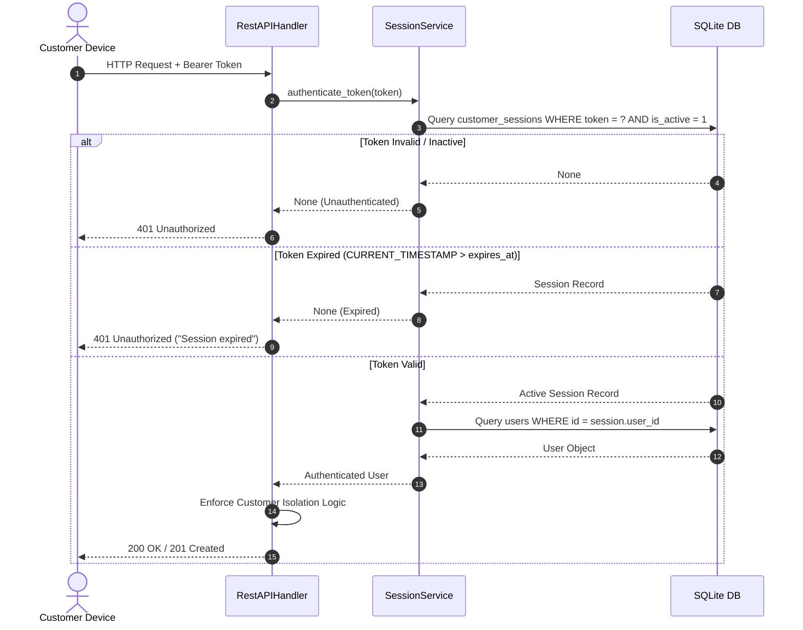

# Customer Session Security & Concurrency Isolation

## 1. Security Overview

In a multi-customer restaurant environment, dining guests access the platform from untrusted public or guest Wi-Fi networks using varied personal hardware (iOS, Android, Windows, macOS, Linux). Security design must guarantee three non-negotiable principles:
1. **Zero Session Cross-Talk:** One customer's actions must never affect, expose, or terminate another customer's session.
2. **Strict Identity Isolation:** Customers must only access their own cart, orders, and payment tracking.
3. **Cryptographic Protection:** Session tokens must resist brute-force prediction and replay attacks.

---

## 2. Session Lifecycle & Token Generation

### 2.1. Cryptographic Randomness
RestoPro uses Python's standard `secrets` library to generate tokens:
```python
import secrets
token = secrets.token_urlsafe(32)  # 256 bits of CSPRNG entropy
```
- **Token Entropy:** 256 bits of cryptographically strong pseudo-random entropy generated by the operating system kernel (`/dev/urandom` or `CryptGenRandom`).
- **Collision Probability:** Less than $10^{-77}$, rendering enumeration or guessing attacks mathematically impossible.

### 2.2. Session Storage & Revocation Schema
Sessions are persisted in the `customer_sessions` database table:
```sql
CREATE TABLE IF NOT EXISTS customer_sessions (
    id INTEGER PRIMARY KEY AUTOINCREMENT,
    token TEXT UNIQUE NOT NULL,
    user_id INTEGER NOT NULL,
    device_info TEXT DEFAULT '',
    ip_address TEXT DEFAULT '',
    created_at TIMESTAMP DEFAULT CURRENT_TIMESTAMP,
    expires_at TIMESTAMP NOT NULL,
    is_active INTEGER DEFAULT 1,
    FOREIGN KEY (user_id) REFERENCES users(id) ON DELETE CASCADE
);
```

### 2.3. Token Verification Flow
Each incoming HTTP request requiring authentication must provide the token via:
- HTTP Header: `Authorization: Bearer <token>`
- Or Query Parameter: `?token=<token>`



---

## 3. Strict Concurrency & Data Isolation

### 3.1. Zero Global State
In legacy single-user prototypes, state is frequently stored in module-level global variables (`current_user`, `cart_items = []`). In a multi-user environment, global variables lead to catastrophic cross-talk where Customer B's cart overwrites Customer A's cart, or Customer B logs out and terminates Customer A's session.

**RestoPro Architecture Rule:**
- Absolutely zero module-level or global variables store customer state.
- Every HTTP request thread retrieves its authenticated identity strictly from the incoming request's session token.
- Repositories and services accept `user_id` as an explicit parameter on every method invocation.

### 3.2. Cart Isolation
Cart data is persisted in `customer_carts`:
```sql
CREATE TABLE IF NOT EXISTS customer_carts (
    id INTEGER PRIMARY KEY AUTOINCREMENT,
    user_id INTEGER NOT NULL,
    menu_item_id INTEGER NOT NULL,
    quantity INTEGER NOT NULL CHECK (quantity > 0),
    created_at TIMESTAMP DEFAULT CURRENT_TIMESTAMP,
    updated_at TIMESTAMP DEFAULT CURRENT_TIMESTAMP,
    UNIQUE (user_id, menu_item_id),
    FOREIGN KEY (user_id) REFERENCES users(id) ON DELETE CASCADE,
    FOREIGN KEY (menu_item_id) REFERENCES menu_items(id) ON DELETE CASCADE
);
```
- Querying `/api/cart` strictly executes: `SELECT ... FROM customer_carts WHERE user_id = ?`.
- Customer A cannot observe dishes added by Customer B, even if both are dining at the same table or ordering identical items simultaneously.

### 3.3. Order Isolation & 403 Forbidden Access Enforcement
When accessing order details (`/api/orders/{id}`) or order tracking (`/api/orders/{id}/track`):
```python
if user.role == "CUSTOMER" and order.user_id != user.id:
    return 403, {"error": "Access denied: cannot track order belonging to another customer."}
```
- Even if a malicious user inspects network traffic and discovers an integer `order_id` belonging to another diner, any attempt to query that order returns `403 Forbidden`.
- Privileged staff roles (`ADMIN`, `MANAGER`, `CASHIER`, `CHEF`, `WAITER`) retain necessary operational visibility across all orders.

### 3.4. Independent Logout
When Customer B logs out:
- Calling `POST /api/auth/logout` sets `is_active = 0` **strictly** for Customer B's specific device token.
- Customer A's token remains valid.
- Customer B's session on another device (e.g. tablet) can also remain valid if multi-device login is permitted, or all sessions for `user_id` can be revoked via `revoke_all_user_sessions(user_id)`.

---

## 4. Attack Mitigations

| Threat Vector | Mitigation Strategy |
|---|---|
| **Token Guessing / Enumeration** | 256-bit CSPRNG URL-safe token space ($2^{256}$ permutations). |
| **Session Fixation** | New cryptographically unique token minted on every login / registration. |
| **Cross-Customer Snooping** | Database foreign keys and controller-level `user_id` verification (403 Forbidden). |
| **SQL Injection** | Parameterized queries (`?` bindings) across all database adapters. |
| **Race Conditions / Double-Spend** | Atomic SQLite transactions (`PRAGMA journal_mode = WAL;`) and retry backoff. |
| **Brute Force Registration** | Password validation (`validate_password`) enforcing minimum length and complexity. |
