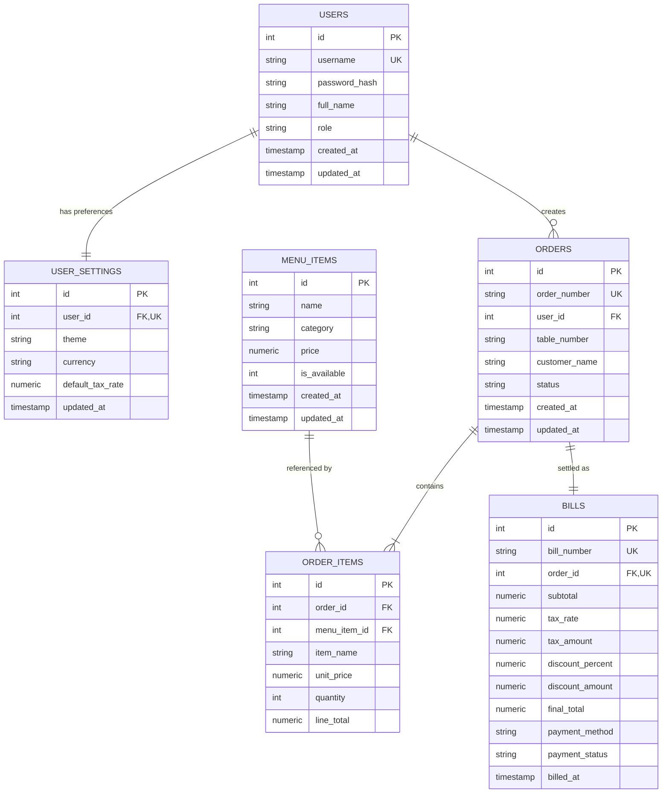

# Database Design Specification

- **Project:** Restaurant Billing System
- **Subject:** BBAT104 — Fundamentals of Total Quality Management
- **Student Name:** Jay Paneru
- **Registration Number:** 2410302024
- **Assigned Quality Goal:** Q08 — Improve User Satisfaction
- **Database Engine:** SQLite 3.x (Local Embedded Relational Storage)
- **Database Path:** `data/restaurant.db` (Isolated Test Path: `tests/test_restaurant.db`)

---

## 1. Entity-Relationship (ER) Diagram



---

## 2. Table Dictionaries & Schema Definitions

### 2.1 Table: `users`
Stores user identities, hashed credentials, and role assignments.
| Column | Type | Constraints | Description |
|--------|------|-------------|-------------|
| `id` | INTEGER | PRIMARY KEY AUTOINCREMENT | Unique user identifier |
| `username` | TEXT | UNIQUE, NOT NULL | Unique login name (3-30 chars) |
| `password_hash` | TEXT | NOT NULL | Salt and PBKDF2-HMAC-SHA256 hash (`salt$hash`) |
| `full_name` | TEXT | NOT NULL | Display name of the user |
| `role` | TEXT | NOT NULL, DEFAULT 'CASHIER' | Role: 'ADMIN', 'CASHIER', 'MANAGER' |
| `created_at` | TIMESTAMP | DEFAULT CURRENT_TIMESTAMP | Account creation timestamp |
| `updated_at` | TIMESTAMP | DEFAULT CURRENT_TIMESTAMP | Last update timestamp |

### 2.2 Table: `user_settings` (Feature 3 & 5)
Persists appearance preferences and defaults per user account.
| Column | Type | Constraints | Description |
|--------|------|-------------|-------------|
| `id` | INTEGER | PRIMARY KEY AUTOINCREMENT | Settings record identifier |
| `user_id` | INTEGER | UNIQUE, NOT NULL, FK -> `users(id)` ON DELETE CASCADE | Target user |
| `theme` | TEXT | NOT NULL, DEFAULT 'dark' | Theme mode: 'dark' or 'light' |
| `currency` | TEXT | NOT NULL, DEFAULT '₹' | Display currency symbol |
| `default_tax_rate` | NUMERIC | NOT NULL, DEFAULT 5.0 | Configurable default GST percentage |
| `updated_at` | TIMESTAMP | DEFAULT CURRENT_TIMESTAMP | Last modification timestamp |

### 2.3 Table: `menu_items`
Stores the active restaurant food and beverage catalog.
| Column | Type | Constraints | Description |
|--------|------|-------------|-------------|
| `id` | INTEGER | PRIMARY KEY AUTOINCREMENT | Unique item identifier |
| `name` | TEXT | NOT NULL | Name of the dish |
| `category` | TEXT | NOT NULL | Category (e.g. Starters, Main Course) |
| `price` | NUMERIC | NOT NULL | Selling price formatted as Decimal string |
| `is_available` | INTEGER | NOT NULL, DEFAULT 1 | 1 = Active/Available, 0 = Unavailable |
| `created_at` | TIMESTAMP | DEFAULT CURRENT_TIMESTAMP | Record created timestamp |
| `updated_at` | TIMESTAMP | DEFAULT CURRENT_TIMESTAMP | Record updated timestamp |
| - | - | UNIQUE(`name`, `category`) | Prevents duplicate names in same category |

### 2.4 Table: `orders`
Stores order tickets created by operators.
| Column | Type | Constraints | Description |
|--------|------|-------------|-------------|
| `id` | INTEGER | PRIMARY KEY AUTOINCREMENT | Unique order record ID |
| `order_number` | TEXT | UNIQUE, NOT NULL | Sequential human-readable code: `ORD-YYYYMMDD-XXXX` |
| `user_id` | INTEGER | NOT NULL, FK -> `users(id)` | Attendant who opened the ticket |
| `table_number` | TEXT | DEFAULT 'Takeaway' | Dining table code or Takeaway indicator |
| `customer_name` | TEXT | DEFAULT 'Walk-in Customer' | Guest name |
| `status` | TEXT | NOT NULL, DEFAULT 'PENDING' | Status: 'PENDING', 'COMPLETED', 'CANCELLED' |
| `created_at` | TIMESTAMP | DEFAULT CURRENT_TIMESTAMP | Order creation timestamp |
| `updated_at` | TIMESTAMP | DEFAULT CURRENT_TIMESTAMP | State transition timestamp |

### 2.5 Table: `order_items` (Historical Price Snapshot)
Itemized line items belonging to an order.
| Column | Type | Constraints | Description |
|--------|------|-------------|-------------|
| `id` | INTEGER | PRIMARY KEY AUTOINCREMENT | Line item identifier |
| `order_id` | INTEGER | NOT NULL, FK -> `orders(id)` ON DELETE CASCADE | Parent order |
| `menu_item_id` | INTEGER | NOT NULL, FK -> `menu_items(id)` | Original menu item |
| `item_name` | TEXT | NOT NULL | Snapshot of item name at time of order |
| `unit_price` | NUMERIC | NOT NULL | Snapshot of unit price at time of order |
| `quantity` | INTEGER | NOT NULL, CHECK(`quantity` > 0) | Quantity ordered ($\ge 1$) |
| `line_total` | NUMERIC | NOT NULL | Computed line total (`quantity * unit_price`) |

### 2.6 Table: `bills`
Stores finalized customer invoices and payment settlement records.
| Column | Type | Constraints | Description |
|--------|------|-------------|-------------|
| `id` | INTEGER | PRIMARY KEY AUTOINCREMENT | Bill identifier |
| `bill_number` | TEXT | UNIQUE, NOT NULL | Sequential invoice code: `BILL-YYYYMMDD-XXXX` |
| `order_id` | INTEGER | UNIQUE, NOT NULL, FK -> `orders(id)` | Settled order |
| `subtotal` | NUMERIC | NOT NULL | Sum of line items in order |
| `tax_rate` | NUMERIC | NOT NULL, DEFAULT 5.0 | GST tax percentage |
| `tax_amount` | NUMERIC | NOT NULL | Calculated tax amount |
| `discount_percent`| NUMERIC | NOT NULL, DEFAULT 0.0 | Applied discount percentage |
| `discount_amount` | NUMERIC | NOT NULL, DEFAULT 0.0 | Calculated discount amount |
| `final_total` | NUMERIC | NOT NULL | Final net payable amount |
| `payment_method` | TEXT | NOT NULL | 'CASH', 'CARD', 'UPI' |
| `payment_status` | TEXT | NOT NULL, DEFAULT 'PAID' | Payment status |
| `billed_at` | TIMESTAMP | DEFAULT CURRENT_TIMESTAMP | Transaction completion timestamp |

---

## 3. Indexes & Performance Optimization

```sql
CREATE INDEX IF NOT EXISTS idx_orders_created_at ON orders(created_at);
CREATE INDEX IF NOT EXISTS idx_orders_status ON orders(status);
CREATE INDEX IF NOT EXISTS idx_bills_billed_at ON bills(billed_at);
CREATE INDEX IF NOT EXISTS idx_menu_category ON menu_items(category);
```

These indexes ensure that date-range queries executed by the **Interactive Dashboard** and **Visual Reports** complete in under 5 milliseconds even with thousands of order records.

---

## 4. Referential Integrity & Historical Protection

1. **Foreign Key Enforcement:** Enabled automatically via `PRAGMA foreign_keys = ON;` upon connection initialization.
2. **Immutable Price Snapshots:** The database explicitly decouples live menu prices from historical invoices. Modifying dish prices or names in `menu_items` never alters past financial bills in `order_items` and `bills`.
3. **Safe Deletion Policy:** Deleting a menu item referenced in existing orders automatically performs a soft-delete (`is_available = 0`), preserving referential integrity and historical invoice auditing.
