# FAILURE MODES & EFFECTS ANALYSIS (FMEA)
## Total Quality Management (TQM) — Risk Mitigation Assessment
**Academic Course:** BBAT104 — Fundamentals of Total Quality Management  
**Student Name:** Jay Paneru | **Registration Number:** 2410302024  
**Primary Quality Goal:** Q08 — Improve User Satisfaction | **Session:** 2026–27

---

## 1. FMEA Framework & RPN Scoring Criteria

The **Failure Modes and Effects Analysis (FMEA)** provides a structured, proactive methodology to identify potential failure points across software architecture, user interaction, and data persistence before they impact operational quality.

Each failure mode is scored across three dimensions on a 1-to-10 scale:
1. **Severity (S):** Impact on customer satisfaction, financial integrity, or system operation (1 = Negligible, 10 = Catastrophic).
2. **Occurrence (O):** Probability or frequency of failure occurrence (1 = Extremely Rare, 10 = Inevitable).
3. **Detection (D):** Likelihood that controls or tests will detect the fault before customer impact (1 = Immediate Automated Detection, 10 = Undetectable).

$$\text{Risk Priority Number (RPN)} = S \times O \times D$$
*Action Threshold: Any failure mode with RPN $\ge$ 100 or Severity $\ge$ 8 demands mandatory Poka-Yoke architectural mitigation.*

---

## 2. Comprehensive FMEA Matrix

| Item # | Process Step / Component | Potential Failure Mode | Potential Effect of Failure | Sev (S) | Potential Cause | Occ (O) | Current Controls | Det (D) | Initial RPN | Poka-Yoke Mitigation / Action Taken | Revised S | Revised O | Revised D | Revised RPN | Status |
| :---: | :--- | :--- | :--- | :---: | :--- | :---: | :--- | :---: | :---: | :--- | :---: | :---: | :---: | :---: | :---: |
| **F-01** | Counter Cash Billing | Cashier tenders less than final total | Financial loss, unbalanced cash drawer | **8** | Cashier typo, rush-hour miscalculation | **6** | Manual cashier calculation | **6** | **288** | Poka-Yoke validation rejects Tender < Total; inline error notification | 4 | 1 | 1 | **4** | **ELIMINATED** |
| **F-02** | Split Billing Settlement | Party shares sum to more or less than bill total | Guest dispute, over/under tax compliance | **8** | Floating-point rounding error, uneven split math | **7** | Cashier manual splitting on calculator | **7** | **392** | Penny-reconciliation algorithm distributes odd paise; custom split variance check blocks saving | 3 | 1 | 1 | **3** | **ELIMINATED** |
| **F-03** | Menu / Kitchen Ordering | Ordering out-of-stock (86) ingredients | Food delayed, customer angry, order cancelled | **7** | Verbal kitchen communication failure | **7** | Chalkboard 86 list | **6** | **294** | Instant digital 86 toggle in SQLite; unavailable items grayed out & disabled on all terminals | 3 | 1 | 1 | **3** | **ELIMINATED** |
| **F-04** | Table / Floor Management | Table vacated while unpaid bill remains open | Revenue loss (walkout), lost order tracking | **9** | Waiter resets table status by mistake | **5** | Floor staff verbal check | **6** | **270** | Poka-Yoke DB guard queries active orders before allowing table status change to VACANT | 4 | 1 | 1 | **4** | **ELIMINATED** |
| **F-05** | Kitchen KDS Dispatch | Cooking ticket lost, customer waits > 30 mins | Extreme customer dissatisfaction (Q08 fail) | **8** | Paper ticket dropped or soaked in oil | **6** | Paper tickets on rail | **7** | **336** | Digital KDS queue with persistent timers and Crimson Alert badge at > 15m wait time | 4 | 1 | 2 | **8** | **ELIMINATED** |
| **F-06** | End of Shift Closeout | Cash drawer variance unaccounted for | Theft, unlocated accounting discrepancy | **7** | Mental arithmetic, missing receipt slips | **5** | Manual register tape tally | **6** | **210** | Shift Closeout module calculates exact system expected cash vs counted cash and audits variance | 3 | 1 | 1 | **3** | **ELIMINATED** |
| **F-07** | User Access & Permissions | Cashier modifies menu price or cancels audits | Financial tampering, unauthorized discounts | **9** | Shared generic user account | **4** | Trust-based staff management | **7** | **252** | Strict RBAC: cashier disallowed from menu/reports/settings at UI and Service layers | 3 | 1 | 1 | **3** | **ELIMINATED** |
| **F-08** | Database Storage | SQLite database corruption during power outage | Complete loss of transaction history | **10** | Abrupt OS shutdown mid-write | **3** | File-system direct writes | **6** | **180** | SQLite WAL (Write-Ahead Logging) mode enabled; PRAGMA synchronous = NORMAL; auto backups | 3 | 1 | 1 | **3** | **ELIMINATED** |
| **F-09** | UI Resolution Scaling | Action buttons (Confirm Payment) clipped off screen | Cashier unable to complete sale on laptop | **8** | Hardcoded fixed window geometry | **6** | Untested 1366x768 screens | **5** | **240** | Bottom action bar packed first with side="bottom"; tested at 1366x768 laptop resolution | 2 | 1 | 1 | **2** | **ELIMINATED** |
| **F-10** | Customer Data Isolation | Customer views other diners' orders or reviews | Data privacy breach, loss of user trust | **8** | Global un-scoped SQL queries | **4** | Code review | **6** | **192** | Strict session scoping: `WHERE user_id = current_user.id`; unit tested in test suite | 2 | 1 | 1 | **2** | **ELIMINATED** |

---

## 3. RPN Reduction Analysis

```mermaid
xychart-beta
    title "FMEA Risk Priority Number (RPN) Reduction Before vs After Mitigation"
    x-axis ["F-01 Tender", "F-02 Split", "F-03 Stockout", "F-04 Table", "F-05 KDS", "F-06 Shift", "F-07 RBAC", "F-08 DB WAL", "F-09 Resolution", "F-10 Privacy"]
    y-axis "Risk Priority Number (RPN)" 0 --> 400
    bar [288, 392, 294, 270, 336, 210, 252, 180, 240, 192]
    bar [4, 3, 3, 4, 8, 3, 3, 3, 2, 2]
```

### Key TQM Outcomes:
- **Total Pre-Mitigation RPN:** 2,654 (Average RPN: 265.4)
- **Total Post-Mitigation RPN:** 34 (Average RPN: 3.4)
- **Overall Risk Reduction:** **98.7% reduction** in potential operational failure severity and occurrence through automated software Poka-Yoke guards.

---
*Authored by Jay Paneru (2410302024) for BBAT104 Total Quality Management.*
