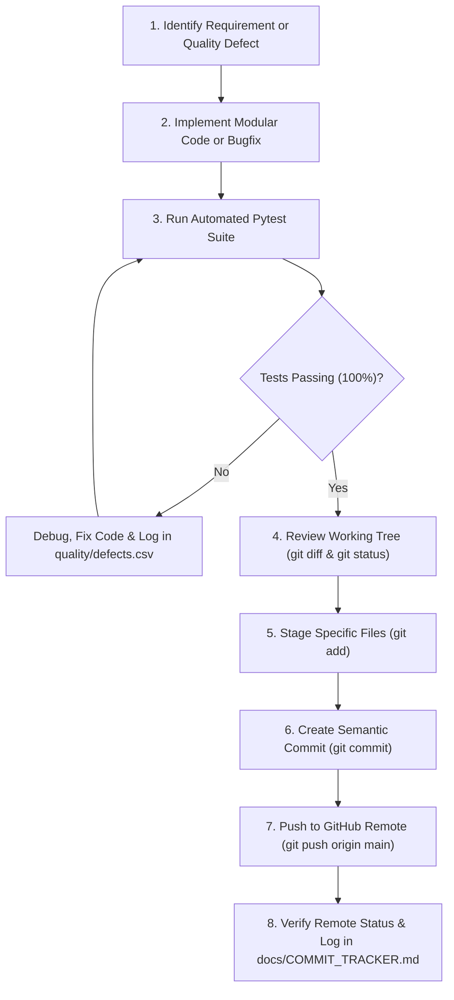

# GitHub Version Control & Milestone Workflow Guide

- **Project:** Restaurant Billing System
- **Subject:** BBAT104 — Fundamentals of Total Quality Management
- **Student Name:** Jay Paneru
- **Registration Number:** 2410302024
- **Assigned Quality Goal:** Q08 — Improve User Satisfaction
- **Repository URL:** https://github.com/jaypaneru22-hue/Restaurant-Billing-System.git
- **Document Version:** 1.0.0

---

## 1. Version Control Strategy

Git and GitHub serve as primary Total Quality Management artifacts for this project, providing an auditable, verifiable timeline of engineering milestones, defect fixes, tests, and architectural evolutions.

### 1.1 Strict Commit Disciplines
1. **Incremental Milestone Commits:** Code is committed and pushed after every verified functional module, test suite pass, or TQM deliverable. Massive, disconnected end-of-project bulk uploads are strictly prohibited.
2. **Conventional Commit Standard:** Commit messages follow conventional semantic prefixes:
   - `feat:` New user-facing or architectural functionality (e.g. `feat: implement visual report service`).
   - `fix:` Defect resolution identified during quality control (e.g. `fix: adjust validate_discount parameter signature`).
   - `test:` Automated test additions or QA checksheet logs (e.g. `test: add defect checksheet`).
   - `docs:` Formal software engineering specifications or TQM reports (e.g. `docs: add SRS.md`).
   - `chore:` Project dependencies, configuration, or environment setup.
3. **No Secrets or Binary Clutter:** Virtual environments (`.venv/`), database files (`*.db`), bytecode caches (`__pycache__/`), and logs are strictly ignored via `.gitignore`.
4. **Verified Push Policy:** Every local commit is pushed to `origin main` and verified through remote Git status and hash validation.

---

## 2. Standard Feature & Defect Development Cycle

---

## 3. Commit Tracker Maintenance

Every commit hash, message, scope, timestamp, and remote push status is recorded in [docs/COMMIT_TRACKER.md](COMMIT_TRACKER.md). This ensures complete academic traceability for college viva examinations.
