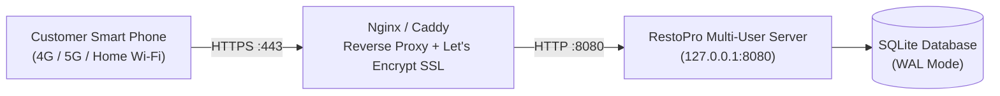

# RestoPro Multi-Device Deployment & Access Guide

## 1. Overview

RestoPro's simultaneous customer access architecture supports three operational deployment models:
1. **Local Development / Single Machine Testing** (`localhost` / `127.0.0.1`)
2. **Restaurant Floor Local Wi-Fi Network** (`0.0.0.0:8080`, accessible to any phone or tablet on restaurant Wi-Fi)
3. **Public Internet / Cloud Production Deployment** (Reverse proxy with HTTPS/TLS encryption via Nginx/Caddy)

---

## 2. Model A: Local Machine Testing

Run both the desktop staff interface and the background multi-device customer web server on your local development machine:

```powershell
# In Windows PowerShell / Command Prompt:
.\.venv\Scripts\python.exe main.py --with-server --server-port 8080
```

Alternatively, to run the lightweight standalone HTTP server independently:
```powershell
.\.venv\Scripts\python.exe server.py --host 127.0.0.1 --port 8080
```

### Access URLs:
- **Mobile Web Portal:** `http://127.0.0.1:8080/`
- **REST API Health:** `http://127.0.0.1:8080/api/health`
- **Menu Catalog JSON:** `http://127.0.0.1:8080/api/menu`

---

## 3. Model B: Restaurant Floor Wi-Fi Deployment (Recommended for On-Premise Dining)

In this deployment model, a central restaurant desktop or server machine runs RestoPro. Customers dining at tables connect their smartphones or tablets to the restaurant's guest Wi-Fi and immediately access the ordering portal without downloading an app.

### 3.1. Startup Command
Launch RestoPro binding to all network interfaces (`0.0.0.0`):
```powershell
.\.venv\Scripts\python.exe server.py --host 0.0.0.0 --port 8080
```
*The server startup script will detect and display your local network IP address (e.g., `192.168.1.45`).*

### 3.2. Windows Firewall Configuration
Allow incoming connections on port `8080` through the Windows Defender Firewall:
```powershell
# Run PowerShell as Administrator:
New-NetFirewallRule -DisplayName "RestoPro Customer Portal (Port 8080)" `
    -Direction Inbound `
    -LocalPort 8080 `
    -Protocol TCP `
    -Action Allow
```

### 3.3. Customer Access Workflow
1. Connect mobile phone or tablet to the restaurant Wi-Fi (e.g. `RestoPro-Guest`).
2. Open any modern browser (Safari, Chrome, Firefox, Samsung Internet).
3. Navigate to:
   ```text
   http://<HOST_LOCAL_IP>:8080
   # Example: http://192.168.1.45:8080
   ```
4. **Table QR Codes:** Generate a QR code encoding `http://192.168.1.45:8080` (or table-specific `http://192.168.1.45:8080?table=Table+1`) and place it on each dining table. Scanning the QR code opens the RestoPro portal instantly.

---

## 4. Model C: Public Internet / Cloud Production Deployment

For public web access across cellular networks (4G/5G) or remote ordering, deploy RestoPro behind a production reverse proxy with SSL/TLS encryption.

### 4.1. Network Architecture


### 4.2. Sample Nginx Configuration
```nginx
server {
    listen 80;
    server_name orders.restopro.com;
    return 301 https://$host$request_uri;
}

server {
    listen 443 ssl http2;
    server_name orders.restopro.com;

    ssl_certificate /etc/letsencrypt/live/orders.restopro.com/fullchain.pem;
    ssl_certificate_key /etc/letsencrypt/live/orders.restopro.com/privkey.pem;

    client_max_body_size 10M;

    location / {
        proxy_pass http://127.0.0.1:8080;
        proxy_http_version 1.1;
        proxy_set_header Host $host;
        proxy_set_header X-Real-IP $remote_addr;
        proxy_set_header X-Forwarded-For $proxy_add_x_forwarded_for;
        proxy_set_header X-Forwarded-Proto $scheme;
    }
}
```

### 4.3. Linux Systemd Service (`restopro.service`)
```ini
[Unit]
Description=RestoPro Multi-Customer Restaurant Server
After=network.target

[Service]
Type=simple
User=restopro
WorkingDirectory=/opt/restopro
ExecStart=/opt/restopro/.venv/bin/python server.py --host 127.0.0.1 --port 8080
Restart=always
RestartSec=3
Environment=RESTOPRO_PORT=8080
Environment=RESTOPRO_HOST=127.0.0.1

[Install]
WantedBy=multi-user.target
```

---

## 5. Verified Supported Client Devices

| Platform | Device / Form Factor | Browser | Status |
|---|---|---|---|
| **Apple iOS** | iPhone 11 / 12 / 13 / 14 / 15 / 16 | Mobile Safari, Chrome iOS | Fully Supported |
| **Apple iPadOS** | iPad Mini / Air / Pro | Safari, Chrome, Firefox | Fully Supported |
| **Android** | Samsung Galaxy, Google Pixel, OnePlus | Chrome Android, Samsung Internet | Fully Supported |
| **macOS** | MacBook Pro, MacBook Air, Mac Mini | Safari, Chrome, Firefox, Edge | Fully Supported |
| **Windows** | Laptops, Surface Pro, Desktops | Chrome, Edge, Firefox, Brave | Fully Supported |
| **Linux** | Desktop Workstations, Chromebooks | Chrome, Chromium, Firefox | Fully Supported |
