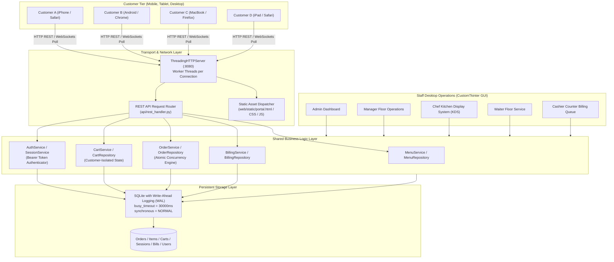

# RestoPro Multi-User Simultaneous Customer Access Architecture

## 1. Executive Summary

RestoPro has transitioned from a single-machine desktop deployment into a **hybrid, concurrent, multi-device restaurant operations platform**. While staff members (Admin, Manager, Cashier, Chef, Waiter) continue to operate via high-performance desktop dashboards (CustomTkinter GUI), **unlimited simultaneous customers** can now access RestoPro from their individual mobile smartphones (iPhone, Android), tablets (iPad, Galaxy Tab), and laptops across the local network (Wi-Fi) or the internet.

---

## 2. System Architecture Diagram

---

## 3. Core Architectural Components

### 3.1. Threading HTTP Server & REST Router
- **Implementation:** `api/http_server.py` and `api/rest_handler.py`.
- **Concurrency Model:** Built on Python's standard `http.server.ThreadingHTTPServer`. Spawns a dedicated OS thread per incoming HTTP socket connection.
- **Portability:** Requires zero third-party dependencies (`fastapi`, `uvicorn`, or external ASGI runtimes are not needed), guaranteeing plug-and-play execution in standard corporate environments.
- **Request Lifecycle:**
  1. Incoming TCP connection accepted on host `0.0.0.0` (all network interfaces) at port `8080`.
  2. Worker thread parses headers, query parameters, and payload body.
  3. `RestAPIHandler.handle_request()` maps route and HTTP method.
  4. Authentication extracted from `Authorization: Bearer <token>` header or query parameters.
  5. JSON response encoded with custom `DecimalJSONEncoder` for high-precision financial amounts.

### 3.2. Session & Cart Isolation Layer
- **No Global Session Variables:** The legacy pattern of storing single-user state in global variables has been completely superseded by request-scoped session tokens.
- **Session Tokens:** 256-bit cryptographically secure, URL-safe random tokens (`secrets.token_urlsafe(32)`) persisted in the `customer_sessions` database table.
- **Persistent Multi-Device Cart:** Customer carts are persisted in the `customer_carts` table, keyed strictly by `(user_id, menu_item_id)`. If a customer switches devices or refreshes their browser, their cart remains intact and entirely isolated from any other diner's cart.

### 3.3. Concurrency-Hardened SQLite Engine
SQLite is renowned for high-throughput single-writer / concurrent-reader performance when configured correctly:
- **Write-Ahead Logging (WAL Mode):** `PRAGMA journal_mode = WAL;` allows reader threads to read simultaneously without being blocked by active write transactions.
- **Busy Timeout:** `PRAGMA busy_timeout = 30000;` instructs database connections encountering a transient lock to wait up to 30 seconds before throwing a busy error.
- **Normalized Sync:** `PRAGMA synchronous = NORMAL;` optimizes disk I/O while preserving durability.
- **Collision-Safe Order Sequencing:** Order numbers (`ORD-YYYYMMDD-XXXX`) utilize atomic transaction increments with an exponential backoff retry loop (`max_retries = 5`) to resolve simultaneous microsecond order creation collisions.

### 3.4. Staff CustomTkinter Real-Time Integration
- Staff desktop views (Admin, Manager, Cashier, Chef, Waiter) directly interface with the shared database and services.
- When Customer A places an order via mobile web, the order is immediately inserted into `orders` and `order_items`.
- The Chef KDS poller retrieves the order on its next active cycle.
- Once marked `READY` by Chef and `SERVED` by Waiter, the order automatically flows into the Cashier's Unbilled Orders queue (`get_pending_billing_orders()`).

---

## 4. REST API Endpoint Catalog

| Method | Endpoint | Auth Required | Description |
|---|---|---|---|
| `GET` | `/` or `/portal` | No | Serves the responsive mobile customer web portal HTML |
| `GET` | `/api/health` | No | Server health check and active connection monitor |
| `POST` | `/api/auth/register` | No | Register new customer account and return session token |
| `POST` | `/api/auth/login` | No | Authenticate customer credentials and return session token |
| `POST` | `/api/auth/logout` | Yes (Bearer) | Revoke current customer device session token |
| `GET` | `/api/auth/me` | Yes (Bearer) | Fetch profile and authentication status of current caller |
| `GET` | `/api/menu` | No | Retrieve active food catalog with prices and categories |
| `GET` | `/api/tables` | No | Retrieve dining tables and floor occupancy status |
| `GET` | `/api/cart` | Yes (Bearer) | Fetch caller's current cart with subtotal & tax |
| `POST` | `/api/cart/add` | Yes (Bearer) | Add dish to caller's cart |
| `POST` | `/api/cart/update` | Yes (Bearer) | Update line item quantity |
| `POST` | `/api/cart/remove` | Yes (Bearer) | Remove line item from cart |
| `DELETE` | `/api/cart/clear` | Yes (Bearer) | Empty caller's cart |
| `POST` | `/api/orders/checkout` | Yes (Bearer) | Atomic order placement dispatched to kitchen |
| `GET` | `/api/orders` | Yes (Bearer) | List orders belonging strictly to authenticated caller |
| `GET` | `/api/orders/{id}` | Yes (Bearer) | Detailed order receipt (enforces 403 on other users) |
| `GET` | `/api/orders/{id}/track` | Yes (Bearer) | 5-step live tracking (Kitchen, Waiter, Billing status) |
| `POST` | `/api/service-requests` | Yes (Bearer) | Summon waiter to table for assistance, water, or bill |
| `GET` | `/api/service-requests` | Yes (Bearer) | Check status of customer's service calls |
| `POST` | `/api/feedback` | Yes (Bearer) | Submit post-meal dining rating and NPS score |
