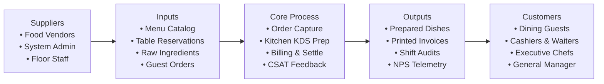
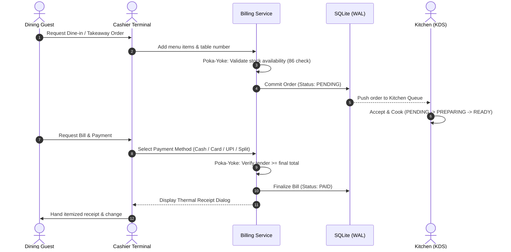
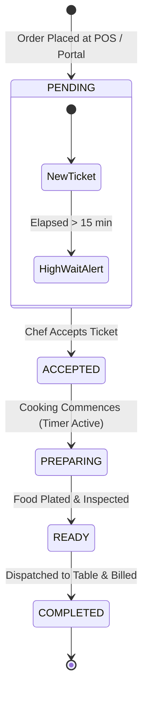
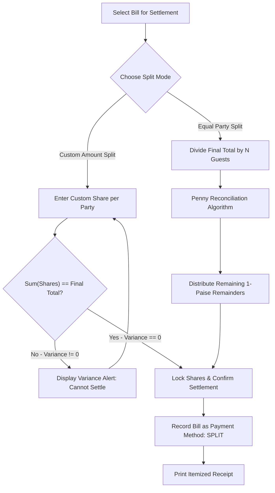

# SIPOC MODEL & PROCESS FLOW DOCUMENTATION
## Total Quality Management (TQM) — BBAT104
**Academic Course:** BBAT104 — Fundamentals of Total Quality Management  
**Student Name:** Jay Paneru | **Registration Number:** 2410302024  
**Quality Goal:** Q08 — Improve User Satisfaction | **Session:** 2026–27

---

## 1. High-Level SIPOC Model

The **SIPOC** framework (Suppliers, Inputs, Process, Outputs, Customers) provides a holistic boundary for the Restaurant Management Platform, illustrating how upstream resources transform into downstream customer value.

### Detailed SIPOC Matrix

| Element | Specification & Operational Boundary |
| :--- | :--- |
| **Suppliers** | • **System Administrator:** System configuration, role permissions, tax & restaurant profile. • **Kitchen Stewards & Vendors:** Food ingredients, inventory restock alerts. • **Cashier & Service Staff:** Dine-in table assignments, order entry, payment tendering. • **Dining Guests:** Order preferences, custom split requests, dining feedback & ratings. |
| **Inputs** | • **Menu Master Data:** Dish names, categories, pricing, 86 availability status. • **Customer Data:** Guest name, contact, table number, dining party size. • **Payment Instruments:** Physical Cash, Simulated Credit/Debit Cards, Simulated UPI VPAs. • **Financial Parameters:** 5.0% Goods & Services Tax (GST), authorized promotional discounts. |
| **Process** | 1. **Order Capture:** Cashier/Customer inputs order line items with quantity validation. 2. **Kitchen KDS Dispatch:** Live ticket generation with cooking timers and status transitions. 3. **Food Production & Expediting:** Kitchen cooks dishes, updates status to `READY`. 4. **Billing & Settlement:** Subtotal computation, tax/discount calculation, split payments. 5. **Drawer Reconciliation:** Shift closeout, cash drawer variance tracking. 6. **Quality Feedback (Q08):** Star rating collection and Net Promoter Score (NPS) logging. |
| **Outputs** | • **Accurate Customer Invoices:** Thermal receipt printout with tax breakdown and QR verification. • **Timely Prepared Food:** Cooked meals dispatched with minimal latency. • **Shift Closeout Reports:** Exportable summary of cash, card, and UPI collections. • **Executive Analytics:** Sales trend charts, payment method distribution, staff activity logs. |
| **Customers** | • **Dining Guests:** High-satisfaction dining experience with transparent order tracking. • **Counter Cashiers:** Ergonomic, mistake-proofed POS interface with keyboard accelerators. • **Kitchen Chefs:** Clutter-free digital ticket board replacing lost paper tickets. • **Restaurant Management & Regulators:** Audit-compliant financial logs and tax reporting. |

---

## 2. End-to-End Operational Process Flows

### Flow 1: Point-of-Sale Order & Settlement Flow

### Flow 2: Kitchen Expediter Lifecycle Flow

### Flow 3: Split Billing Reconciliation Flow

---
*Authored by Jay Paneru (2410302024) for BBAT104 Total Quality Management.*
