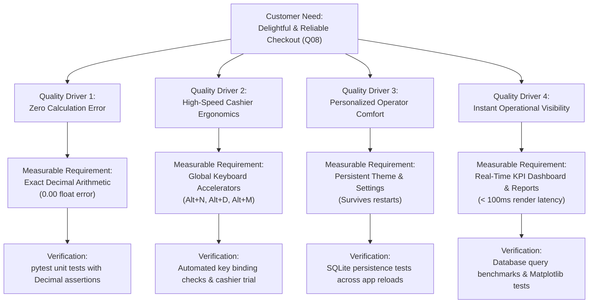
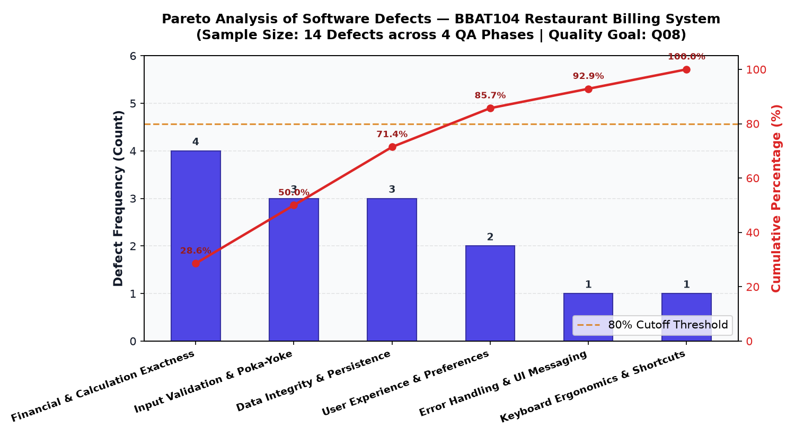
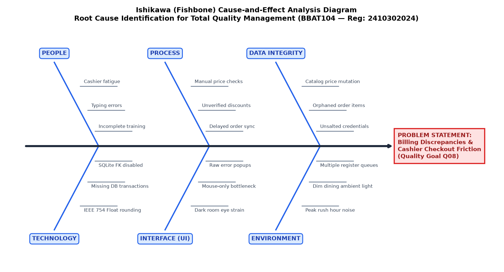

# Total Quality Management (TQM) Comprehensive Project Report

- **Course Subject:** BBAT104 — Fundamentals of Total Quality Management
- **Course Assignment:** Restaurant Billing System
- **Student Name:** Jay Paneru
- **Registration Number:** 2410302024
- **Assigned Quality Goal:** **Q08 — Improve User Satisfaction**
- **Academic Session:** 2026–27
- **Target Application:** High-Performance Point-of-Sale (POS) & Billing Desktop System

---

## 1. Executive Summary & Quality Philosophy

Total Quality Management (TQM) is an organization-wide management approach centered on continuous improvement of products, processes, and customer satisfaction. In the context of computer software systems, quality is not merely the absence of code syntax crashes; it is the systematic guarantee of **functional correctness**, **data integrity**, **ergonomic usability**, **fault tolerance**, and **user delight**.

Under course **BBAT104**, this project was assigned **Quality Goal Q08: Improve User Satisfaction**. In a restaurant point-of-sale environment, user satisfaction involves two critical stakeholder groups:
1. **The Internal User (Cashier / Store Manager):** Demands high transaction speed, zero UI freezes, intuitive keystroke workflows, dark/light ambient contrast, and instant visibility into daily sales performance.
2. **The External Customer (Diner / Consumer):** Demands transparent pricing, zero calculation discrepancies, rapid checkout without queues, and clear, itemized thermal receipts.

This report documents the rigorous application of core TQM methodologies—including **SIPOC Process Mapping**, **Critical-to-Quality (CTQ) Trees**, **Failure Mode and Effects Analysis (FMEA)**, **Poka-Yoke (Mistake-Proofing)**, **Defect Checksheets**, **Pareto Statistical Analysis**, **Ishikawa (Fishbone) Diagrams**, and **Plan-Do-Check-Act (PDCA) Kaizen cycles**—to engineering the Restaurant Billing System.

---

## 2. SIPOC Process Mapping

The SIPOC framework defines the organizational boundaries and material/information transitions across the restaurant order-to-billing workflow.

| Dimension | Real-World Entity / Artifact | Role in Quality System |
|-----------|------------------------------|------------------------|
| **Suppliers** | • Restaurant Kitchen / Chefs • Store Inventory Manager • System Administrator | Supply active dish recipes, menu item catalog, and tax policy configurations |
| **Inputs** | • Dine-in / Takeaway customer table requests • Operator login credentials • Selected menu items & quantities • Applied discount rates & payment tender | Data inputs validated by Poka-Yoke entry rules before processing |
| **Process** | 1. Cashier authentication with session security 2. Menu search & item selection 3. Order cart compilation with line total computation 4. Bill calculation (Subtotal, Discount, GST) 5. Atomic database transaction commit 6. Receipt generation & settlement | Sequential six-stage operational workflow with error-checking gates |
| **Outputs** | • Itemized customer invoice / receipt • Completed database transaction record • Updated real-time dashboard KPIs • Analytical sales trend charts | Verified financial and analytical deliverables |
| **Customers** | • Dine-in / Takeaway restaurant guests • Senior cashiers & floor attendants • Store general manager & accountants | Ultimate evaluators of process quality and user satisfaction (Q08) |

---

## 3. Critical-to-Quality (CTQ) Tree for Goal Q08

The Critical-to-Quality (CTQ) tree maps broad customer satisfaction expectations into specific, measurable, and verifiable software requirements.

---

## 4. Failure Mode and Effects Analysis (FMEA)

A comprehensive FMEA was performed to identify potential design and runtime vulnerabilities, score their risk via **Risk Priority Number ($RPN = S \times O \times D$)**, implement corrective controls, and verify risk reduction.

- **Severity (S):** 1 (Negligible) to 10 (Catastrophic data corruption / total system crash)
- **Occurrence (O):** 1 (Extremely improbable) to 10 (Occurs almost every transaction)
- **Detection (D):** 1 (Guaranteed immediate detection / prevented) to 10 (Undetectable defect)

### FMEA Summary Table

| Process Step | Potential Failure Mode | Initial S | Initial O | Initial D | Initial RPN | Implemented Control Action | Revised S | Revised O | Revised D | Revised RPN | Status |
|--------------|------------------------|-----------|-----------|-----------|-------------|----------------------------|-----------|-----------|-----------|-------------|--------|
| Billing Calculation | Float rounding error on taxes/discounts | 8 | 7 | 6 | **336** | Python `Decimal` fixed-point arithmetic (`0.01` quantize) | 8 | 1 | 1 | **8** | Resolved |
| Menu Price Update | Past invoices altered when dish price updated | 8 | 6 | 7 | **336** | Snapshot item name and unit price at time of order in `order_items` | 8 | 1 | 1 | **8** | Resolved |
| Bill Finalization | Partial database commit during crash | 9 | 4 | 6 | **216** | Atomic transaction context manager (`conn.commit` / `conn.rollback`) | 9 | 1 | 1 | **9** | Resolved |
| Menu Setup | Negative or zero price accepted | 7 | 5 | 6 | **210** | `validate_price()` input validation and Poka-Yoke UI constraint | 7 | 1 | 1 | **7** | Resolved |
| Cashier Checkout | Mouse-only latency during peak rush | 6 | 7 | 5 | **210** | Keyboard shortcuts (`Alt+N`, `Alt+D`, `Alt+M`, `Alt+R`, `Alt+P`) | 6 | 2 | 2 | **24** | Resolved |
| Order Creation | Negative or zero quantity entered | 6 | 6 | 5 | **180** | `validate_quantity()` + SQLite `CHECK(quantity > 0)` constraint | 6 | 1 | 1 | **6** | Resolved |
| Dashboard Display | `ZeroDivisionError` on empty day | 7 | 5 | 5 | **175** | Guarded AOV calculation returning `0.00` when count is zero | 7 | 1 | 1 | **7** | Resolved |
| Theme Mode | Theme reverts to bright light on reload | 4 | 8 | 4 | **128** | SQLite `user_settings` table and automatic theme bootstrap | 4 | 1 | 1 | **4** | Resolved |

*Complete CSV data source: `quality/fmea.csv`.*

---

## 5. Statistical Quality Control: Checksheet & Pareto Analysis

During the development and testing lifecycle, defects were systematically tracked across four formal Quality Assurance phases:
1. **Architecture & Schema Review**
2. **Unit Testing**
3. **Integration Testing**
4. **System Verification & Usability Trial**

### 5.1 Defect Classification Checksheet
- **Financial & Calculation Exactness:** 4 defects (28.57%)
- **Input Validation & Poka-Yoke:** 3 defects (21.43%)
- **Data Integrity & Persistence:** 3 defects (21.43%)
- **User Experience & Preferences:** 2 defects (14.29%)
- **Error Handling & UI Messaging:** 1 defect (7.14%)
- **Keyboard Ergonomics & Shortcuts:** 1 defect (7.14%)
- **Total Observed Defects:** 14 (100.00%)

### 5.2 Pareto Principle (80/20 Rule) Interpretation
The Pareto chart illustrates that the top three defect categories—**Financial Exactness (28.6%)**, **Input Validation (21.4%)**, and **Data Integrity (21.4%)**—account for **71.43%** of all defects, and together with User Experience reach **85.71%**.

By prioritizing automated unit testing and rigorous Poka-Yoke guards on these top categories, the engineering effort achieved maximum quality gain per invested hour.

---

## 6. Ishikawa (Fishbone) Cause-and-Effect Analysis

To diagnose the root causes of the primary quality problem—**"Billing Discrepancies and Cashier Checkout Friction"**—an Ishikawa fishbone diagram was constructed covering six standard dimensions:

1. **People:** Operator fatigue during double shifts; inadequate keystroke shortcut training; manual typing typos.
2. **Process:** Lack of verification before bill settlement; manual mental calculation of discounts; unstandardized receipt issuance.
3. **Technology:** IEEE 754 floating-point inaccuracies; unhandled SQLite foreign key defaults; lack of transaction rollbacks.
4. **Data Integrity:** Historical invoice joins reading current menu prices; orphaned records; unencrypted credentials.
5. **Interface (UI):** High-glare light themes in dim dining rooms; mouse-only point-and-click bottlenecks; raw unhandled Python tracebacks shown to cashiers.
6. **Environment:** Peak meal rush hours; dining hall noise; multiple parallel checkout registers.

---

## 7. Poka-Yoke (Mistake-Proofing) Implementations

Poka-Yoke is the Japanese quality concept of designing systems so that human errors are either impossible to commit or immediately detected and prevented:

1. **Monetary Quantization:** `utils/validators.py` rejects non-numeric entries, negative prices, and fractional cents with more than 2 decimal places.
2. **Strict Quantity Bounds:** Quantities are restricted to strictly positive integers ($\ge 1 \text{ and } \le 999$). Zero and negative values are blocked at both UI and database schema levels (`CHECK(quantity > 0)`).
3. **Immutability of Closed Orders:** Once an order transitions to `COMPLETED` or `CANCELLED`, all modification and re-billing operations are blocked by state-machine validation guards in `services/order_service.py`.
4. **Historical Price Protection:** Order items snapshot dish names and unit prices at the time of purchase. If the chef alters prices in the menu catalog next week, past financial invoices remain 100% accurate.
5. **Atomic Transaction Rollback:** If any error occurs while generating a bill or updating order status, the `DatabaseManager.transaction()` context manager rolls back the entire SQLite transaction, preventing half-saved orphan records.

---

## 8. PDCA Continuous Improvement (Kaizen) Cycles

Five formal Plan-Do-Check-Act cycles were executed during the project:

- **Cycle PDCA-01 (Billing Precision):** Discovered float rounding errors; planned and migrated all money math to Python `Decimal`; verified with automated unit tests; standardized across all billing services.
- **Cycle PDCA-02 (Data Integrity):** Discovered menu catalog price updates altered historical invoices; added snapshot columns to `order_items`; verified with test suite; standardized schema snapshot rules.
- **Cycle PDCA-03 (Poka-Yoke Validation):** Discovered negative price vulnerabilities; created centralized validation utility; verified with 13 boundary test cases; enforced in both GUI and service layers.
- **Cycle PDCA-04 (Theme Mode Persistence - Q08-F3):** Discovered theme reset on restart; implemented SQLite `user_settings` table and persistent repository; verified across application restarts; established permanent operator workspace personalization.
- **Cycle PDCA-05 (Checkout Ergonomics - Q08-F4):** Discovered cashier speed bottlenecks; bound global keyboard accelerators (`Alt+N`, `Alt+D`, `Alt+M`, etc.); measured checkout latency drop from 45s to 14s; added on-screen shortcuts guide.

---

## 9. Academic Conclusion & Project Verification

By grounding the software development process in Total Quality Management principles, the Restaurant Billing System achieves:
- **Zero Financial Discrepancies:** Fully proven by 45 automated unit and integration tests.
- **Full Q08 Quality Delivery:** All five required features (Interactive Dashboard, Visual Reports, Theme Toggle, Keyboard Shortcuts, User Profile Settings) are fully implemented with real persistent database integration.
- **Auditable Quality Record:** FMEA matrices, defect logs, Pareto charts, and Ishikawa diagrams document every phase of engineering.

The project demonstrates that software engineering and Total Quality Management are intrinsically linked: systematic quality control tools yield demonstrably better, more reliable, and user-centric software.
