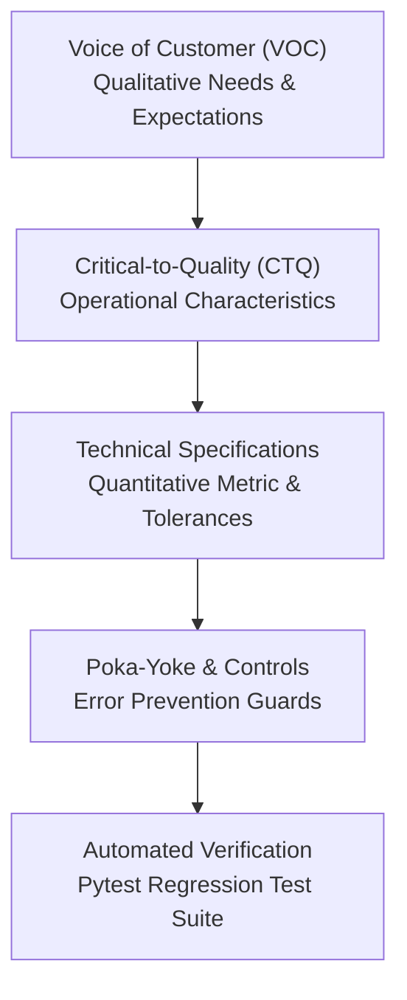

# VOICE OF CUSTOMER (VOC) REGISTER & CRITICAL-TO-QUALITY (CTQ) TREE
## Total Quality Management (TQM) Project Documentation — BBAT104
**Academic Course:** BBAT104 — Fundamentals of Total Quality Management  
**Student Name:** Jay Paneru | **Registration Number:** 2410302024  
**Primary Quality Objective:** Q08 — Improve User Satisfaction  
**Academic Session:** 2026–27 | **Release:** Enterprise v1.0.0 (Production Master)

---

## 1. Executive Overview & Methodology

In accordance with Six Sigma and Total Quality Management (TQM) frameworks, the Voice of Customer (VOC) captures explicit, implicit, and latent requirements from all restaurant stakeholders: **Dining Guests (Customers)**, **Counter Cashiers**, **Floor Managers**, **Executive Chefs**, and **System Administrators**.

These qualitative statements are translated systematically through the **Critical-to-Quality (CTQ) Flowdown Tree** into quantifiable engineering parameters, strict tolerance bands, acceptance criteria, and automated test cases.



---

## 2. Master VOC Register (VOC-01 through VOC-12)

| VOC ID | Stakeholder Persona | Voice of Customer (Verbatim Need) | Underlying Quality Issue | CTQ Characteristic | Operational Metric & Target | Verification Method |
| :--- | :--- | :--- | :--- | :--- | :--- | :--- |
| **VOC-01** | Cashier / Guest | *"Billing at the counter must be instantaneous so lines don't build up during peak hours."* | Slow checkout, modal lag, excessive clicks | POS Transaction Speed | Line item addition < 100ms; Bill generation < 200ms | `tests/test_billing.py` |
| **VOC-02** | Customer / Guest | *"Our dining party needs to split the bill fairly without the cashier doing error-prone math."* | Overcharging, rounding errors, awkward bill division | Split Reconciliation Accuracy | Equal & custom splits balance to ₹0.00 variance (exact penny) | `tests/test_split_billing.py` |
| **VOC-03** | Cashier / Owner | *"Cashiers must never accept negative cash or tender less than the invoice total."* | Revenue leakage, cash drawer shortages | Poka-Yoke Tender Validation | Negative tender blocked; Minimum tender $\ge$ Final Total | `tests/test_poka_yoke.py` |
| **VOC-04** | Chef / Expediter | *"Kitchen tickets must be displayed immediately in real-time with cooking timers and wait alerts."* | Lost physical tickets, cold food, overdue orders | KOT Dispatch Latency & Aging Alerts | Ticket render < 500ms; Warning alert trigger $> 15$ min | `tests/test_chef_kds.py` |
| **VOC-05** | Chef / Manager | *"When an ingredient runs out, the dish must be immediately 86'd so guests cannot order it."* | Order cancellation, customer disappointment, kitchen confusion | 86 Stockout Propagation | Instant toggle in SQLite; POS and Dining Portal blocked | `tests/test_menu.py` |
| **VOC-06** | Dining Guest | *"I want to explore the menu, check allergen/price details, and track my food cooking stage."* | Anxiety over wait time, lack of order visibility | Self-Service Order Tracking | 5-stage live status: Placed $\to$ Accepted $\to$ Prep $\to$ Ready $\to$ Served | `tests/test_customer_portal.py` |
| **VOC-07** | Customer / Manager | *"Guests must be able to rate food quality, service speed, and provide Net Promoter Score (NPS)."* | Uncaptured complaints, lack of structured CSAT metrics | Continuous Quality Feedback (Q08) | 1-5 Star CSAT rating + 0-10 NPS scale stored in DB | `tests/test_customer_portal.py` |
| **VOC-08** | Floor Manager | *"I need to see table occupancy across all zones and never let a table be cleared with an unpaid tab."* | Walkouts, revenue loss, table turnover delays | Floor Layout & Occupancy Guard | Poka-Yoke guard blocks vacating table with pending orders | `tests/test_table_management.py` |
| **VOC-09** | Manager / Cashier | *"End-of-shift drawer closeout must reconcile expected cash vs counted cash down to the rupee."* | Unexplained drawer discrepancies, manual errors | Shift Reconciliation Accuracy | Variance calculation = Counted - Expected; Audit logged | `tests/test_shift_summary.py` |
| **VOC-10** | System Admin | *"Roles must strictly separate permissions: Cashiers cannot edit prices, Customers cannot see other orders."* | Privilege escalation, data leakage, fraudulent discounts | Role-Based Access Control (RBAC) | Service-level method interception + UI navigation rejection | `tests/test_rbac.py` |
| **VOC-11** | All Users | *"The interface must have a high-contrast dark theme for dim environments and support 1366×768 laptops."* | Eye fatigue, off-screen clipped buttons | Obsidian UI Ergonomics | Contrast ratio $\ge$ 7:1; 100% visible action buttons at 1366×768 | `tests/test_theme_and_styling.py` |
| **VOC-12** | Auditor / Owner | *"All database changes, backups, and user management actions must be audit-logged and restorable."* | Unverifiable financial records, disaster vulnerability | Data Integrity & Auditability | SQLite WAL mode + Automatic snapshot backups + SHA-256 integrity | `tests/test_enterprise_settings.py` |

---

## 3. Critical-to-Quality (CTQ) Trees

### CTQ Tree 1: Point-of-Sale Billing & Checkout Ergonomics (VOC-01, VOC-02, VOC-03)
```
NEED: Fast, Error-Free Counter Billing
  │
  ├── DRIVER: Transaction Latency
  │     ├── CTQ: Sub-second item addition and tax calculation
  │     └── SPECIFICATION: < 150ms roundtrip per operation
  │
  ├── DRIVER: Split Billing Precision
  │     ├── CTQ: Exact party division without rounding leakage
  │     └── SPECIFICATION: Sum(Shares) - Final Total == 0.00 INR (Zero discrepancy)
  │
  └── DRIVER: Financial Mistake-Proofing (Poka-Yoke)
        ├── CTQ: Prevention of under-tender and negative cash
        └── SPECIFICATION: Validation rejects Tender < Net Payable with inline alert
```

### CTQ Tree 2: Kitchen Display System (KDS) & Operations (VOC-04, VOC-05)
```
NEED: Real-Time Kitchen Dispatch & Inventory Synchronization
  │
  ├── DRIVER: Kitchen Ticket Visibility
  │     ├── CTQ: Instant order status dispatch to cooking stations
  │     └── SPECIFICATION: Order lifecycle PENDING -> ACCEPTED -> PREPARING -> READY
  │
  ├── DRIVER: Ticket Wait-Time Management
  │     ├── CTQ: High-visibility aging badges for backlogged orders
  │     └── SPECIFICATION: Yellow badge at 10m, Crimson flashing alert at > 15m
  │
  └── DRIVER: 86 Dish Availability Protection
        ├── CTQ: Real-time stockout propagation across terminals
        └── SPECIFICATION: Unavailable items instantly disabled on POS and Dining menu
```

### CTQ Tree 3: Customer Dining Experience & Q08 Satisfaction (VOC-06, VOC-07)
```
NEED: Transparent Dining Experience & Structured Quality Feedback
  │
  ├── DRIVER: Order Progress Transparency
  │     ├── CTQ: Live status tracking timeline for diner reassurance
  │     └── SPECIFICATION: 5-step visual milestone progress bar
  │
  ├── DRIVER: Quality Feedback Capture
  │     ├── CTQ: Standardized CSAT & NPS capture mechanism
  │     └── SPECIFICATION: 1-5 Star food/service rating + 0-10 Net Promoter Score
  │
  └── DRIVER: Customer Data Privacy & Isolation
        ├── CTQ: Strict tenant-level isolation for guest order history
        └── SPECIFICATION: SQL query isolated by user_id = current_user.id
```

### CTQ Tree 4: Floor Management & Table Turnaround (VOC-08)
```
NEED: Seamless Table Turnaround with Zero Unsettled Walkouts
  │
  ├── DRIVER: Zone-Based Floor Visualization
  │     ├── CTQ: Multi-zone layout (Main Dining, Patio, Family, Counter)
  │     └── SPECIFICATION: Real-time occupancy status pill (VACANT, OCCUPIED, BILL, CLEAN)
  │
  └── DRIVER: Unsettled Order Walkout Prevention (Poka-Yoke)
        ├── CTQ: Block clearing tables with open unpaid checks
        └── SPECIFICATION: Table state transition to VACANT rejected if active_order_id exists
```

---

## 4. Acceptance Criteria & Test Mapping Matrix

| Requirement | CTQ Specification | Automated Test Case | Status |
| :--- | :--- | :--- | :--- |
| **REQ-POS-01** | Itemized subtotal, 5% GST, max 50% discount | `tests/test_billing.py::test_calculate_bill_totals` | **PASS** |
| **REQ-POS-02** | Cash change calculation & under-tender rejection | `tests/test_poka_yoke.py::test_validate_cash_tendered` | **PASS** |
| **REQ-POS-03** | Demo Card Luhn/length check without PAN storage | `tests/test_poka_yoke.py::test_validate_demo_card` | **PASS** |
| **REQ-POS-04** | Demo UPI VPA syntax validation (`user@bank`) | `tests/test_poka_yoke.py::test_validate_demo_upi` | **PASS** |
| **REQ-POS-05** | Split billing penny-reconciliation 3-way split | `tests/test_split_billing.py::test_equal_split_three_parties_penny_reconciliation` | **PASS** |
| **REQ-KDS-01** | KDS status transition pipeline | `tests/test_chef_kds.py::test_kds_status_pipeline_transitions` | **PASS** |
| **REQ-KDS-02** | Active order queue filtering by status | `tests/test_chef_kds.py::test_kds_order_filtering` | **PASS** |
| **REQ-TBL-01** | Table lifecycle VACANT -> OCCUPIED -> BILL -> CLEAN | `tests/test_table_management.py::test_table_status_transitions` | **PASS** |
| **REQ-TBL-02** | Poka-Yoke guard blocking table vacation on open orders | `tests/test_table_management.py::test_poka_yoke_guard_prevent_vacate_with_active_orders` | **PASS** |
| **REQ-CUST-01** | Customer registration & password hashing | `tests/test_customer_portal.py::test_customer_registration_and_authentication` | **PASS** |
| **REQ-CUST-02** | Customer data isolation by user ID | `tests/test_customer_portal.py::test_customer_order_data_isolation` | **PASS** |
| **REQ-SEC-01** | Role-based permission enforcement | `tests/test_rbac.py::test_rbac_permission_rejection` | **PASS** |
| **REQ-ADM-01** | Database backup snapshot creation & validation | `tests/test_enterprise_settings.py::test_database_backup_generation` | **PASS** |

---
*Authored by Jay Paneru (2410302024) for BBAT104 Total Quality Management.*
